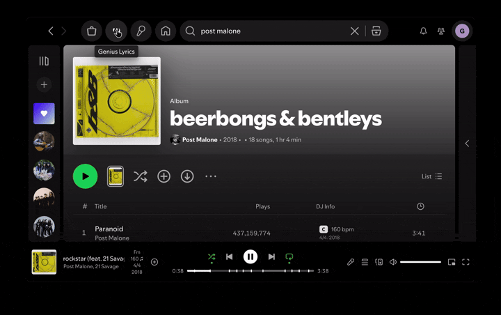

# Genius Lyrics

View Genius annotated lyrics for the song currently playing in Spotify.



Parts of this project are based on [lyrics-plus](https://github.com/spicetify/modules/tree/main/modules/lyrics-plus).

## Features

- Displays **lyrics and annotations from Genius** for the current track.
- Click an annotated line to read the **explanation and quotes** attached to it.
- Switch to the **About** or **Q&A** tab for the rest of what Genius knows about the song.
- **Synced lyrics**: Highlights the current lyric line as the song plays. _(Experimental)_

## Requirements

The Spicetify daemon must be running.
Genius does not send `Access-Control-Allow-Origin`, so requests need to go through a CORS proxy.

## Installation

Install it from the Spicetify Marketplace when available, or build it from source:

```sh
git clone https://github.com/Golevka2001/genius-lyrics.git
cd genius-lyrics
bun install
bun run build
bunx spicetify-kit install dist/genius-lyrics@0.2.0
spicetify apply
```

Use the versioned directory generated in `dist/` if the package version changes.

## Usage

1. Start the Spicetify daemon.
2. Open **Genius Lyrics** from Spotify's navigation bar.
3. Play a song. The app loads its Genius lyrics automatically.
4. Click an annotated lyric line to expand its notes.
5. Use the tabs to read the About or the Q&A instead.

## Planned

- [x] `Verified`/`Unreviewed` annotation labels, with the author's avatar and name.
- [ ] Comments and external links.
- [x] Song bio and song Q&A, beside the annotations.
- [ ] Annotation and lyrics translations.
- [x] Live annotation count while annotations are loading.
- [ ] Annotation markers in the scrollbar.
- [x] Time anchors for annotations.
- [x] Loading indicators for images.
- [ ] ...

## Troubleshooting

### Genius cannot be reached

Make sure the Spicetify daemon is running, then reopen Genius Lyrics or click Retry.

### No lyrics are shown

Not every song has lyrics on Genius.

Check the track and artist information, or click Retry to try again.

### Synced lyrics are missing or incomplete

Synced lyrics are _experimental_.

Some songs have no synced timeline.

And Spotify may combine multiple Genius lines into one timestamp sometimes, so some lines may be skipped.

### Annotations are still loading

Lyrics and annotations are fetched separately.

Lyrics can appear before the annotations finish loading; slow connections may leave some lines in a loading state temporarily.
